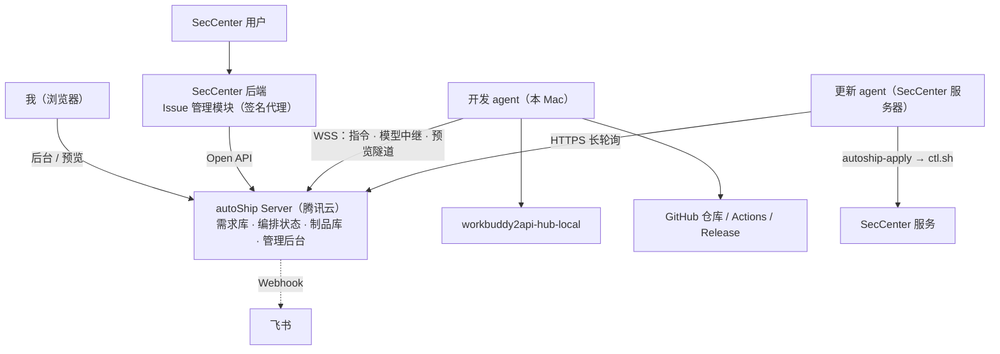
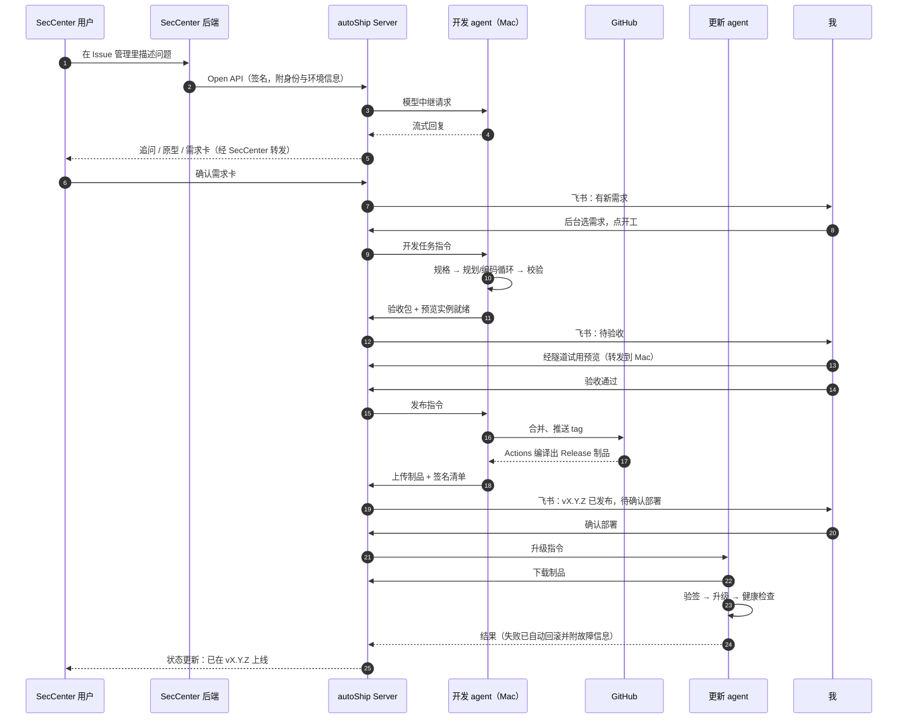
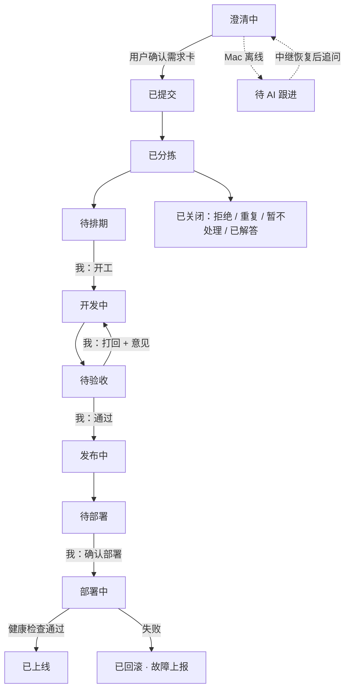
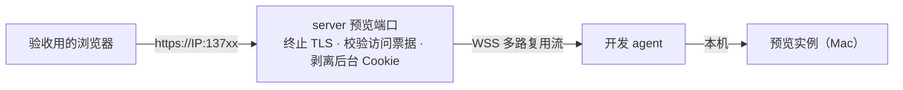
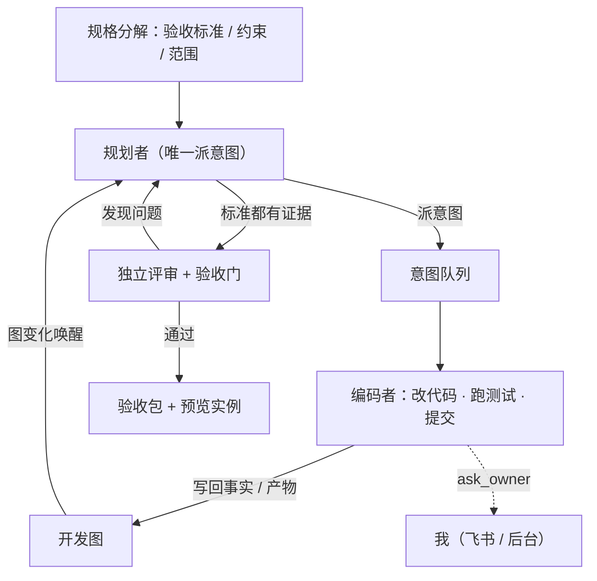

# autoShip 方案设计（草案 v0.2）

> 日期：2026-11-15 ｜ 版本：v0.2（并入 5 项后续确认）｜ 状态：方案讨论稿，尚未开工 ｜ 文件编码：UTF-8

---

## 1. 目标

把“用户提出问题 → 新版本上线”做成闭环：

1. 业务系统（先接 SecCenter）的用户提 bug / 需求，AI 客服通过对话问清楚，产出结构化需求卡和可视原型；
2. autoShip 汇总、去重、分类、统计、归档；
3. 我登录后台挑选需求、点“开工”，Mac 上的开发 agent 按 ARTEX 的思路自动开发、测试，产出验收包和预览实例；
4. 我验收通过后，自动合并、打 tag，由 GitHub Actions 编译发布，制品签名后上传到 autoShip；
5. 我在后台确认部署后，SecCenter 服务器上的更新 agent 拉取新版本并升级，失败自动回滚，并把故障信息回传 server。

全流程有三个人工关口：**开工**、**验收**、**部署确认**。其余步骤自动执行，需要我决策时通过飞书找我。

## 2. 已确认的关键决策

| # | 决策点 | 结论 | 带来的设计影响 |
|---|---|---|---|
| 1 | 客服 AI 用的模型 | 对话逻辑跑在 server；模型调用经 Mac 开发 agent 中继到本机 workbuddy2api-hub-local | Mac 离线时客服降级为“留言模式”，Mac 上线后异步追问 |
| 2 | 验收方式 | 验收包 + Mac 上的预览实例 | 开发 agent 要管理测试库、端口池和预览进程 |
| 3 | 技术栈 | 与 SecCenter 一致：Go + Gin + GORM + MySQL 8，Angular + ng-zorro，前端内嵌单文件部署 | 复用 SecCenter 的认证、OTP、配置加密、部署脚本 |
| 4 | 开发引擎 | 基于 norma SDK（ARTEX 同款底座）自研循环，预留执行器接口 | 模型地址 / 密钥 / 模型自配；工具权限、审计、门禁全可控 |
| 5 | 服务器地址 | 只有公网 IP，没有备案域名 | autoShip 自建 CA 签发 IP 证书；各端固定 CA 指纹；常用电脑装一次 CA |
| 6 | 预览访问 | 验收用的电脑不一定和 Mac 在同一局域网 | 预览实例经 server 隧道访问；同一局域网时也可直连 |
| 7 | 升级前备份数据库 | 不备份 | 更新 agent 不需要数据库账号；“迁移只增不删”升级为发布硬门禁 |
| 8 | 升级时机 | 每次手动确认 | 新增“待部署”状态：版本发布后飞书通知，我在后台确认才下发 |
| 9 | 更新 agent 运行账号 | 专用账号 + 受限 sudo | 权限分离：常驻进程无特权，替换程序由 root 小工具再次验签后执行 |

## 3. 总体架构



| 端 | 部署位置 | 职责 | 网络连接 |
|---|---|---|---|
| autoShip Server | 腾讯云 | 需求库、会话、编排状态、制品库、部署记录、管理后台、Open API、客服 AI 的对话逻辑、预览隧道入口 | 只接受连接（后台端口 + 预览端口段）；主动出站只有飞书 |
| 开发 agent | 本 Mac | 研发循环、测试库与预览实例、发布流水线、模型中继 | 主动连 server（一条 WSS 承载指令、进度、模型中继、预览隧道）；访问本机模型和 GitHub |
| 更新 agent | SecCenter 服务器 | 心跳与版本上报、按固定流程升级 / 回滚、故障回传 | 只主动连 server（HTTPS 长轮询） |
| Issue 管理模块 | SecCenter 内 | 对话界面、我的反馈；后端做签名代理，不保存业务数据 | SecCenter 后端 → server Open API |

通信原则：

- 两个 agent 都在 NAT / 内网后面，只**主动出站**连 server，互不直连，也不连 SecCenter；
- Mac 不对外开放任何端口，预览实例也走开发 agent 那条 WSS 的反向隧道；
- 更新 agent 只从 server 下载制品，不访问 GitHub；
- SecCenter 用户的浏览器不直连腾讯云，请求一律经 SecCenter 后端转发（对内网友好，不用改 CSP / CORS）。

## 4. 端到端流程



### 4.1 需求状态机



| 状态 | 含义 | 推动方 |
|---|---|---|
| 澄清中 | 对话进行中 | 提交人 + 客服 AI |
| 待 AI 跟进 | Mac 离线时以留言提交，中继恢复后追问 | 系统 |
| 已提交 | 提交人确认了需求卡 | 提交人 |
| 已分拣 | AI 自动分类、查重、建议优先级 | 系统（可人工改） |
| 待排期 | 我接受了，排队等开工 | 我 |
| 开发中 | 已开工（含校验、打回后返工） | 开发 agent |
| 待验收 | 验收包和预览实例就绪 | 我 |
| 发布中 | 变更日志、tag、CI、签名、上传 | 开发 agent |
| 待部署 | 版本已发布并上传，等我确认部署 | 我 |
| 部署中 | 更新 agent 执行升级 | 更新 agent |
| 已上线 | 上线检查通过 | 系统 |
| 已回滚 | 部署失败、已自动回滚，故障信息已上报；可重新部署或另开修复任务 | 系统 / 我 |
| 已关闭 | 拒绝 / 重复（并入主需求）/ 暂不处理 / 已解答（咨询类） | 我 / 系统 |

## 5. autoShip Server

### 5.1 模块划分

目录结构沿用 SecCenter 的 `internal/modules/<name>/{model,repository,service,handler,routes.go}`。

| 模块 | 职责 |
|---|---|
| auth | 后台登录（密码 + OTP）、会话、登录限流 |
| product | 产品档案：仓库、默认分支、构建 / 测试命令、模块目录、产品知识、部署目标与策略 |
| integration | 接入方：App ID / 密钥、IP 白名单、回调地址；Open API 验签 |
| intake | 澄清会话、消息、附件、需求草稿、原型版本；运行客服 AI |
| requirement | 需求库：状态机、分拣、查重合并、提出人与计数、标签、归档 |
| work | 开发任务：关联需求、状态与门禁、验收包、预览信息、验收意见 |
| run | 开发运行镜像：开发图、活动流、会话记录、用量（数据来自开发 agent 同步） |
| release | 版本：版本号、变更日志、包含的任务、tag / commit、CI 运行、制品清单与签名 |
| artifact | 制品存储：本地磁盘，保留最近 N 个版本；以后可换腾讯云 COS |
| deploy | 部署目标、部署确认、部署记录与分步日志、回滚记录 |
| tunnel | 预览隧道：预览端口段分配、访问票据、HTTP 反向代理（经开发 agent 的 WSS） |
| agent | agent 注册、凭据、心跳、在线状态、指令队列、模型中继通道 |
| llm | 模型调用抽象：relay（经开发 agent，当前）/ direct（直连，预留）；用量统计 |
| prompt | 提示词版本管理：正文可编辑、代码固定的安全尾段不可编辑，一键回滚 |
| notify | 飞书 Webhook 推送；向接入方回调需求状态 |
| stats | 统计看板 |
| audit | 后台操作、指令下发、审批、部署的全量审计 |

### 5.2 管理后台

- **总览**：待处理需求、开发中、待验收、待部署、最近发布与部署；agent 在线状态（开发 agent、模型中继、各更新 agent 及其版本）。
- **需求池**：按产品 / 模块 / 类型 / 状态 / 提出人数筛选；详情含完整对话、需求卡、原型、重复项、提出人、时间线；操作：分拣、合并、拒绝、开工（可多选合并为一个开发任务）。
- **开发任务**：实时视图（开发图、活动流、待办清单、各道门状态）；和任务助手对话；回答 agent 的提问；“打开预览”一键经隧道访问；验收（通过 / 打回 + 意见）。
- **版本**：变更日志、制品与签名、CI 运行链接、部署历史；“确认部署”弹窗展示变更日志、包含的需求、是否含表结构变更、目标当前版本，确认后才下发。
- **部署**：部署目标与 agent、部署分步日志、手动回滚。
- **统计 / 设置 / 审计**：设置含产品、接入方、agent 注册、提示词、通知规则、部署策略、预览端口段。

### 5.3 客服 AI（需求澄清）

运行方式：server 上每个会话对应一个 norma 会话。只提供**无副作用**的工具（不能执行命令、不能读写文件），模型调用走中继（见 7.5）。

| 工具 | 作用 |
|---|---|
| ask_user | 一次只问一个问题，最多 4 个可点选项 + 自由输入，前端渲染成按钮 |
| update_draft | 按需求类型更新草稿的结构化字段 |
| lookup_product | 查产品知识（模块、页面、已有功能、常见问题），咨询类当场解答 |
| search_similar | 在同产品的需求库里找相似需求 |
| propose_duplicate | 询问“是不是和 #123 同一个”，确认后计数 +1 并关注该需求 |
| render_prototype | 生成单文件 HTML 低保真原型（产品风格），可迭代多版 |
| propose_summary | 输出需求卡，请提交人确认 |
| submit | 提交；由代码校验必填项齐全、提交人已明确确认，否则拒绝 |

必填信息（按类型）：

- **缺陷**：所在页面 / 模块、操作步骤、期望结果、实际结果、出现频率、影响范围、报错或截图。版本、页面路由、浏览器、角色、最近的前端报错和失败请求由 SecCenter 自动附带，用户不用填。
- **新功能 / 改进**：使用角色、要解决的问题（为什么）、期望行为（做什么）、不包含的范围、验收标准（Given / When / Then）、界面期望（生成原型）、使用频率、紧急程度。
- **咨询**：能用产品知识解答的直接回答，不进需求库，只计入统计。

原型：

- 单个 HTML 文件，不引用任何外部资源；放在沙箱 iframe（不给 `allow-same-origin`，配严格 CSP）里渲染，生成的内容影响不到宿主页面；
- 按产品风格生成（SecCenter：侧边栏 + 顶栏 + ng-zorro 风格的表格 / 表单），风格说明来自产品知识；
- 用户说“按钮放右边”“加一列状态”就生成新版本；最终版本随需求进入开发，作为编码者的界面参考；
- 缺陷类不出原型，改出“复现卡”。

完成门（借鉴 ARTEX 的目标含糊检查）：提交由代码把关，必填项缺失或含糊、提交人没明确确认需求卡时一律拒绝。

离线降级（Mac 不在线或模型不可用）：

- 前端自动切换成按类型的结构化表单（留言模式），提交后状态为“待 AI 跟进”；
- 中继恢复后，server 按先进先出处理积压：分析材料、生成追问；提交人在 SecCenter「我的反馈」看到“有新追问”角标后继续，异步完成澄清。

防滥用：用户输入一律按数据处理；每个会话有 token 预算；按提交人限频；附件限类型（png / jpg / webp）和大小（≤ 10 MB）。

### 5.4 需求库与统计

- **自动分拣**（经中继，离线时排队）：类型、所属模块、严重度 / 优先级建议、重复候选、标签、工作量估计（S / M / L）、可开工度（验收标准是否可验证）。
- **查重合并**：保留主需求，重复项保留各自的对话；“提出人数”累计；所有提出人都收到状态更新。
- **统计**：
  - 数量：按产品 / 模块 / 类型 / 状态；每周新增与关闭趋势；提出人数排行；
  - 效率：提交→上线、开工→待验收、待验收→上线的周期；
  - 质量：验收一次通过率、上线后同问题复报率、部署成功率与回滚次数；
  - 成本：每个开发任务的 token 用量与耗时。
- **归档**：关闭的需求只读、可全文检索，以后支持导出。

### 5.5 Open API 与嵌入方式

认证：每个接入方一对 App ID / 密钥；请求头带时间戳、随机数和签名（HMAC-SHA256，覆盖方法、路径、时间戳、随机数、请求体摘要）；5 分钟时间窗 + 随机数防重放；可选 IP 白名单。

| 接口（草案） | 说明 |
|---|---|
| `POST /open/v1/conversations` | 新建会话，带提交人身份和环境信息 |
| `POST /open/v1/conversations/{id}/messages` | 发消息；SSE 流式返回 AI 回复、选项、原型、需求卡 |
| `POST /open/v1/attachments` | 上传截图 |
| `POST /open/v1/conversations/{id}/confirm` | 提交人确认需求卡 |
| `GET /open/v1/reporters/{rid}/issues` | 某提交人的反馈列表与状态 |
| `GET /open/v1/issues/{id}` | 需求详情与时间线 |
| 回调 | `issue.status_changed` / `issue.follow_up` / `issue.released` |

嵌入方式：

1. **服务端集成**（SecCenter 采用）：宿主后端做代理，界面由宿主自己做，风格统一；
2. **嵌入式挂件**（后期）：一段 JS 打开 autoShip 托管的对话 iframe，身份用宿主后端签发的短期令牌，适合用户能直接访问公网的系统。

## 6. SecCenter「Issue 管理」模块

- **后端** `server/internal/modules/issue`：
  - 鉴权 SecCenter 用户，附带身份（用户 ID、姓名、角色、组织）和环境（版本、页面路由），用 App 密钥签名后转发 autoShip，SSE 流式回传浏览器；
  - 本地只保存 autoShip 连接配置：地址、App ID / 密钥（沿用 SecCenter 的 AES-256-GCM 加密方式）、autoShip CA 指纹；不保存需求和对话。
- **前端**菜单「Issue 管理」：
  - 提交反馈：对话界面、选项按钮、截图粘贴 / 上传、原型预览（沙箱 iframe）、需求卡确认；
  - 我的反馈：列表 + 状态时间线 + “有新追问”角标；
  - 全部反馈（管理员）：查看本系统所有用户的反馈，只读，管理在 autoShip 做；
  - 可选：全局悬浮“反馈”入口，自动带上当前页面。
- **权限**：`issue:submit`（默认所有角色）、`issue:all`（查看全部）、`issue:settings`（连接配置）。
- 与现有「工单中心」（`ticket`，漏洞整改工单）区分，菜单名和权限前缀都不同。

## 7. 通信协议、模型中继与预览隧道

### 7.1 统一消息信封

```text
{ id, type, seq, ack, ts, payload }
```

- 指令至少投递一次，接收方按 `id` 幂等；
- server 端指令队列状态：待投递 → 已投递 → 执行中 → 成功 / 失败 / 过期；
- 事件带递增 `seq`，断线重连后从最后确认的 `seq` 续传。

### 7.2 传输方式

| agent | 传输 | 原因 |
|---|---|---|
| 开发 agent | WSS 长连接，上面多路复用指令、进度流、模型中继流、预览隧道流；15 秒心跳；断线指数退避重连；本地发件箱缓存离线期间的事件 | 需要双向实时和多条并发的流 |
| 更新 agent | HTTPS 长轮询（挂起 30 秒）+ POST 上报 | 频率低；企业网络代理对 WebSocket 支持不稳，长轮询最稳 |

### 7.3 注册与认证

1. 后台新建 agent，生成一次性注册令牌（15 分钟有效）；
2. agent 首次启动时在本地生成 Ed25519 密钥对，用令牌登记公钥；
3. 之后每个请求都用 agent 私钥签名，按授权范围访问：更新 agent 只能访问自己部署目标的制品和部署记录；开发 agent 可访问开发任务、发布、模型中继、预览隧道；
4. 后台可随时吊销。

### 7.4 证书（只有公网 IP）

- autoShip 首次启动时生成自己的 CA，再签发服务端证书，把公网 IP 写进证书的 SAN；
- 开发 agent、更新 agent、SecCenter 的 Issue 模块都**固定 CA 指纹**，不固定服务端证书本身——以后换证书、换 IP 重签都不用改各端；
- 常用的电脑把 autoShip CA 装进系统信任一次，后台和预览都不再报证书警告；
- 服务器建议绑定弹性公网 IP，避免 IP 变化；国内机房的 80 / 443 端口受备案管控，用 IP 直连时建议改用非标准端口（如后台 8443），少一层不确定性。

### 7.5 模型中继

- server 端实现统一的模型调用接口，当前实现为 **relay**：把 OpenAI Chat Completions 请求（`stream=true`）经开发 agent 的 WSS 发过去，开发 agent 转给本机 workbuddy2api-hub-local，再把流式分片原样回传；
- server 只按“角色”请求（intake / triage），开发 agent 在本地把角色映射到具体模型配置；API 密钥只在 Mac 上，server 拿不到；
- 中继只转发到 Mac 上已配置的模型接口，不是通用代理，不能访问任意地址；每个请求限制 `max_tokens`，整体限速；
- 客服对话这类交互请求有独立的并发槽，优先于后台开发任务，开发占满额度时客服也不会卡住；
- server 实时掌握中继是否可用（agent 在线 + 最近一次模型探活），不可用就触发降级；
- 预留 **direct** 实现：以后在腾讯云配了可直连的接口，改配置就能切换，不用改代码。

### 7.6 预览隧道



- **按端口区分预览**：server 预留一小段端口（如 13700–13709），每个预览实例占一个，验收结束就回收。不用 `/preview/<id>/` 这种路径前缀，是因为 SecCenter 前端和接口都默认部署在根路径，加前缀要改写页面和接口地址，容易出错；只有 IP 也没法用子域名区分；
- **链路**：浏览器 → server 预览端口（server 用 autoShip CA 签发的证书终止 TLS）→ 开发 agent 的 WSS 多路复用流 → Mac 本机预览实例；Mac 不对外开放端口；
- **访问控制**：在后台点“打开预览”时签发一次性短期票据，第一次访问用票据换一个绑定该端口的访问 Cookie；没有有效 Cookie 的请求一律拒绝；预览停止后立即失效；
- **Cookie 隔离**：浏览器的 Cookie 不按端口隔离，同一 IP 下后台的登录 Cookie 也会被带到预览端口；预览跑的又是还没验收的代码。因此 server 转发前剥掉后台 Cookie，并拦截预览响应里与后台同名前缀的 Set-Cookie；
- **保留原始 Host**：SecCenter 有功能用请求里的 Host 拼导出链接，隧道转发时保留浏览器看到的地址；
- **流式转发**：按 HTTP 流转发，支持大文件下载和分块响应。SecCenter 浏览器端没有用 WebSocket，后端也不校验 Origin，按 HTTP 反向代理即可跑通；WebSocket 透传等以后有产品需要再加；
- **带宽**：预览流量经腾讯云中转，首次加载会受服务器带宽限制；和 Mac 在同一局域网时，验收包里同时给出局域网直连地址。

## 8. 开发 agent（本 Mac）

### 8.1 运行环境

- Go 单文件，launchd 用户级服务开机自启；有任务在跑或有预览实例时用 `caffeinate` 阻止休眠；
- 引擎：norma 的 agentcore / harness / tool / permission / hook / compaction / transcript；统一执行器接口，以后可以接 Codex CLI 等执行器；
- 模型配置：多个 profile（地址、密钥、模型、格式：Chat Completions / Responses / Anthropic Messages），默认指向 workbuddy2api-hub-local（`http://127.0.0.1:8788/v1`）；按角色映射（规划者、编码者、评审者、客服中继）；熔断 + 故障转移（借鉴 ARTEX 的 llmpool）；每个任务有 token / 时长 / 轮数预算；
- 密钥存 macOS 钥匙串；
- 本地状态：用 Mac 上已经在跑的 MySQL，独立库 `autoship_agent`，和 server 共用 GORM 模型代码；会话记录以 JSONL 落盘；server 保存镜像。

### 8.2 工作区与测试资源

- 不碰你自己的工作目录（`/Users/user1/workspace/SecCenter`）；
- 每个产品一份专用克隆 `~/autoship/repos/<产品>`；每个开发任务一个 git worktree `~/autoship/work/<产品>/<任务ID>`，分支 `autoship/<任务ID>-<简述>`；
- 专用 MySQL 账号 `autoship`，只授权 `sc_test_%`、`sc_preview_%` 前缀的库；测试库每次运行时创建、结束后删除，碰不到你的 `seccenter` 开发库；
- 端口池（如 13600–13699）给测试 / 预览服务用，不和 12614、4200 冲突；登记自己启动的进程 PID，只清理自己的进程；
- 页面检查：用本机已装的 Google Chrome 通过 CDP（chromedp）截图和冒烟，不下载 Playwright 自带的浏览器（会超过 10 MB 限制）；
- GitHub：推送用现有 SSH key；PR / Actions / Release 用 GitHub REST API + 细粒度 PAT（本机没装 gh CLI）；网络不通时走本机代理。

### 8.3 研发循环（对照 ARTEX）



| ARTEX 概念 | 在 autoShip 开发 agent 中 | 说明 |
|---|---|---|
| 目标分解器 goals | 规格分解器 | 需求 → 可验证的验收标准（目标节点）+ 允许 / 禁止约束 + 改动范围 + 技术方案 |
| 规划者 planner | 规划者 | 唯一派意图的角色；开发图变化（防抖）即唤醒；每次唤醒是新会话，但共享一份跨唤醒的待办清单，串行链路（建表 → 接口 → 页面 → 测试）按依赖逐步派发；判断哪些验收标准已被证明 |
| 执行者 worker | 编码者 | 只领一条意图：改代码、跑相关构建和单测、提交 commit、写回事实和产物后即停，不自行扩展方向；写代码的意图默认串行（同一工作区），只读调研类意图可并行 |
| 对抗门 / 复测者 | 独立评审者 | 独立会话、可换模型：对照需求、约束、开发规范评审代码，尝试构造反例补测试，检查可疑改动（鉴权绕过、新增外联、硬编码凭据、无关改动） |
| 证据校验 | 验收门（代码实现） | 每条验收标准必须绑定本次运行真实产生的证据（测试名 + 退出码 + 输出摘录、构建日志、截图），由代码核验，不信模型自述 |
| 主 agent（人在环路） | 任务助手 | 我在后台和它对话：问进度、加提示、加验收标准或约束、对正在跑的意图实时纠偏 |
| ask_operator | ask_owner | 需要决策或资料时暂停该意图，飞书 + 后台通知，回复后带着答案继续 |
| guard / intercept | 工具守卫 | 每次工具调用前检查：命令与路径规则、受保护路径审批、依赖策略；全量审计 |
| 操作约束 constraints | 约束块 | 你的开发规范 + 仓库内的 agent 说明文件 + 任务级约束，以最高优先级注入规划者和编码者 |
| 目标含糊检查 goal gate | 开工前检查 | 需求缺少可验证的验收标准时提示补充，避免白烧 token |
| 停滞检测 | 停滞检测 | 同一错误指纹、同一失败测试或同一方向重复 3 次仍无进展 → 提醒规划者换思路，仍不行就 ask_owner |
| 收尾 wrap-up | 收尾 | 步数或时间用尽时先提交 WIP commit，写回已完成和未完成的事实，下一轮接着做 |
| 终态分类 + 重试 | 终态分类 + 重试 | 模型调用失败退避重试；预算耗尽标记 exhausted，由规划者换方向 |
| 任务时钟 | 预算 | 每个开发任务的 token / 时长 / 轮数上限，用尽即暂停并通知 |
| worker 跨过程检索 | 过程检索 | 编码者可检索同一任务里其他意图的执行过程（报错、发现），减少重复劳动 |
| 不可信边界 | 不可信边界 | 需求原文、截图文字、外部内容都标记为数据，不当作指令 |
| 提示词版本 + 代码固定尾段 | 同左 | 提示词正文可在后台编辑、有版本可回滚；安全规则写在代码里，不可编辑 |
| 跨任务经验（RSI 循环 B） | 经验库（P4） | 从验收打回意见、评审发现中提炼候选经验，**须我批准**才注入提示词 |

### 8.4 开发图与项目地图

- **开发图**（每个开发任务一张，对应 ARTEX 的探索图）：
  - 节点：目标（验收标准）、意图（开发步骤）、事实（代码位置、接口约定、失败原因等观察）、产物（commit、diff、截图、报告）、发现（评审 / 测试发现的问题）、提示（我的指导）；
  - 边：派生、产出、证明、阻塞。
- **项目地图**（每个产品一张，跨任务共享，对应 ARTEX 的资产图）：模块、目录、关键接口、数据表、测试命令；每次发布后刷新，并导出为 server 端的“产品知识”，供客服 AI 使用。

### 8.5 一个开发任务的阶段

1. **准备**：拉代码、建 worktree、建测试库、装依赖；
2. **规格**：生成验收标准、约束、改动范围、技术方案（“方案确认”门按产品可选，默认关闭）；缺陷类先在测试库复现并写出失败的测试，再做根因分析和同类问题排查；
3. **开发**：规划者 ⇄ 编码者循环，直到每条验收标准都有证据；
4. **校验**：全量构建、全量测试、静态检查、规范门禁、独立评审、改动页面截图；不通过就回到开发；
5. **打包**：生成验收包、启动预览实例并开通隧道 → 待验收，飞书通知我；
6. **发布**：验收通过后执行（见 8.9）。

### 8.6 开发规范自动化门禁

| 规范 | 自动化方式 |
|---|---|
| 注释 | 新增 / 修改的 Go 函数和类型必须有文档注释（AST 检查）；TS 类和方法必须有 JSDoc |
| 数据库注释 | 新建表必须有表注释；GORM 字段必须带 `comment` 标签 |
| UTF-8 | 所有改动文件做 UTF-8 合法性检查 |
| 依赖版本 | 新增或变更依赖时查注册表发布时间：未满 30 天、或有 LTS 却没选 → 暂停任务并飞书上报，等你确认；不擅自升级已有依赖 |
| 依赖体积 | 新组件超过 10 MB → 立即暂停并飞书上报 |
| Bug 修复 | 缺陷类任务必须产出根因分析和同类问题排查清单，由评审门检查 |
| 迁移只增不删（因升级前不备份数据库） | 检测删除 / 重命名表或字段、收窄字段类型的迁移 → 阻断发布，须你单独审批；含任何表结构变更的版本在“确认部署”弹窗里醒目提示 |
| 端口占用 | 只清理自己登记过 PID 的进程 |
| 飞书上报 | ask_owner 统一走你的飞书 Webhook，同时在后台生成待办卡片 |

### 8.7 工具守卫

- 工作目录锁定在本任务的 worktree；
- **禁止**：模型直接 `git push`（推送只由发布流水线的代码执行）；worktree 之外的删除和 `git reset --hard`；`sudo`；`curl | sh`；读取 `~/.ssh` 和钥匙串；修改 git 全局配置；
- **需审批**：改 `.github/`、`deploy/`、`Makefile`；依赖变更（走依赖策略）；破坏性数据库迁移（走 8.6 的迁移门禁）；
- 所有调用记审计日志并同步到 server。

### 8.8 验收包与预览实例

| 验收包内容 | 说明 |
|---|---|
| 验收标准对照表 | 每条标准的状态和证据链接 |
| 改动说明 | AI 写的摘要 + diff 统计 + 关键 diff |
| 构建与测试 | 通过 / 失败 / 新增的测试，涉及的模块 |
| 评审结论 | 发现的问题及处理情况 |
| 页面截图 | 改动页面的前后对比 |
| 风险提示 | 数据库迁移（是否含表结构变更）、配置变更、依赖变更 |
| 预览实例 | 隧道访问入口 + 局域网直连地址 + 预览专用的随机测试账号 |
| 成本 | token 用量、耗时 |

预览实例：

- 本地编译候选版本（与测试用同一个 Makefile 目标），用预览配置启动：从端口池分配端口；预览库 `sc_preview_<任务ID>` 由 agent 按本需求生成演示数据（不用生产数据）；自签证书（SecCenter 生产模式只提供 HTTPS）；
- 访问方式：后台“打开预览”经 server 隧道访问（见 7.6），在哪台电脑都能用；和 Mac 在同一局域网时也可以直连 `https://<Mac局域网IP>:<端口>`，速度更快；
- 保留到验收结束，或空闲 24 小时后自动停止，同时回收 server 上的预览端口；
- 注意：预览是 darwin/arm64 构建，和生产的 linux/amd64 制品有平台差异（如办公字体资源需单独提供），最终以 GitHub Actions 产物 + 上线健康检查为准。

### 8.9 发布流水线

验收通过后由**代码**按固定步骤执行，模型只负责写变更日志的文字：

1. 拉取最新 main，把任务分支 rebase 上去；main 有新提交时重跑校验；
2. 定版本号：含新功能升次版本号，纯修复升修订号；验收弹窗里可以改；
3. 生成 `CHANGELOG.md` 的 `## [vX.Y.Z] - 日期` 小节并提交（SecCenter 的 release.yml 缺这一节会直接失败）；
4. 快进合并到 main，推送 main，推送 tag → 触发 GitHub Actions 的 release.yml；
5. 轮询 Actions 结果；失败则任务进入“发布失败”，附日志并飞书通知；
6. 下载 Release 制品，确认来自本次 tag 对应的 commit，计算 SHA-256；生成清单（产品、版本、tag、commit、文件名 / 大小 / 哈希、变更日志、是否含表结构变更、最低更新 agent 版本），用 Mac 钥匙串里的 Ed25519 私钥签名；
7. 分片续传上传到 server → 版本状态变为“待部署” → 飞书通知我确认部署；
8. 清理 worktree、测试库、预览实例；刷新项目地图并同步产品知识。

同一产品的发布串行执行；多个开发任务可以并行开发（默认 1 个，可调），每个任务发布前都会 rebase 并复验。

## 9. 更新 agent（SecCenter 服务器）

### 9.1 权限分离

| 组成 | 运行身份 | 职责 |
|---|---|---|
| `autoship-agent` 常驻进程 | 专用账号 `autoship-agent`，无特权 | 连 server、心跳、下载制品到暂存目录、首次验签、健康检查、上报 |
| `autoship-apply` 小工具 | root（经 sudo），只能执行固定子命令 | 再次验签后调用 ctl.sh 升级或回滚；按固定条数读取 seccenter 服务日志 |

- sudo 规则只放行几条完整命令，不带通配参数：

  ```text
  autoship-agent ALL=(root) NOPASSWD: /usr/local/sbin/autoship-apply upgrade, /usr/local/sbin/autoship-apply rollback, /usr/local/sbin/autoship-apply logs
  ```

- `autoship-apply` 只从固定暂存目录取制品和清单，先复制到 root 专属目录，再用 root 持有的公钥（如 `/etc/autoship/release.pub`）验签，然后才交给 ctl.sh——防止验签后文件被替换；即使常驻进程被攻破，也装不上未签名的程序；
- `autoship-apply` 本身和公钥文件归 root 所有，其他账号不可写；
- 查服务状态用 `systemctl is-active seccenter`，不需要 root。

### 9.2 配置与心跳

- 配置项：server 地址、autoShip CA 指纹、agent 身份密钥、部署目标 ID、健康检查地址；**不需要数据库账号**；发布签名公钥由 root 持有；
- 每 30 秒心跳：agent 版本、SecCenter 版本、服务状态、磁盘、运行时长。

### 9.3 固定流程

只执行内置流程，不接受任意命令：

| 流程 | 说明 |
|---|---|
| deploy 升级 | 只在我于后台确认部署后下发，步骤见 9.4 |
| rollback 回滚 | `autoship-apply rollback`，回到本机上一份备份 |
| diagnose 诊断（P4） | 采集服务状态、最近 N 行日志、磁盘与内存、版本；脱敏、限大小；用于分析线上 bug |
| self_update 自更新（P4） | 用同一套签名机制更新自己 |

部署策略按部署目标配置，默认“每次手动确认”；以后可按目标改成发布后立即升级或维护窗口。

### 9.4 升级步骤

每一步都上报进度：

1. 校验清单签名、产品与目标匹配、版本高于当前版本（降级只能走 rollback 流程）；
2. 预检：服务正在运行、磁盘剩余 ≥ 制品大小的 3 倍、没有其他部署在跑（文件锁）；
3. 断点续传下载制品到暂存目录，校验大小和 SHA-256；
4. `sudo autoship-apply upgrade`：复制 → 再次验签 → `ctl.sh upgrade`（候选自检 `--check-office`、备份旧程序、停服、原子替换、启动，启动失败自动恢复）；
5. 上线检查：60 秒内 `/api/healthz` 正常且版本号等于目标版本；前 60 秒日志里没有 panic；登录页返回 200；
6. 上线检查失败 → `sudo autoship-apply rollback` → 确认旧版本健康；
7. 上报结果：成功 / 失败已回滚 / 回滚也失败（飞书紧急通知）。失败时附故障信息：失败步骤、退出码、stderr 末尾、日志末尾、健康检查响应。

其他要求：

- 按部署 ID 幂等；本地记录操作日志，agent 自己中途重启也能如实上报最终状态；
- 升级前不备份数据库：回滚只恢复程序，新版本做过的表结构变更会保留，所以依赖“迁移只增不删”这道发布硬门禁（见 8.6、第 10 节）。

## 10. SecCenter 前置改造

| 改造 | 原因 |
|---|---|
| 服务端编译时注入版本号和 commit，并增加 `--version` 参数 | 目前只给扫描 Agent 注入了版本，服务端程序自身没有版本信息 |
| 新增免登录的 `/api/healthz`（返回状态 + 版本） | 目前没有全局健康检查接口，更新 agent 无法判断升级是否成功 |
| ctl.sh 放到服务器上的固定路径（如 `/opt/seccenter/bin/ctl.sh`），归 root 所有 | install.sh 不会复制 ctl.sh；`autoship-apply` 需要稳定、可信的调用位置 |
| 数据库迁移只增不删（发布硬门禁） | 升级前不备份数据库，回滚旧程序时必须仍能使用新表结构；破坏性迁移须人工审批 |
| Issue 管理模块（含 autoShip CA 指纹配置） | 见第 6 节；autoShip 只有 IP、用自建 CA |

## 11. 安全设计

| 方面 | 措施 |
|---|---|
| 更新通道（风险最高：等于能替换生产程序） | 清单用 Ed25519 签名，私钥只在 Mac 钥匙串里；常驻进程无特权，替换程序由 root 小工具复制后再次验签才执行；即使 server 或常驻进程被攻破，也推不了未签名的程序；只执行固定流程；防降级；每次部署须我确认 |
| 证书 | 只有 IP：自建 CA + IP 证书；各端固定 CA 指纹；常用电脑安装 CA |
| agent 身份 | 一次性注册令牌 → Ed25519 身份 → 请求签名；按范围授权；可吊销 |
| Open API | HMAC 签名 + 时间戳 + 随机数防重放；每个接入方独立密钥；可选 IP 白名单 |
| 管理后台 | 密码 + OTP、HttpOnly Cookie、登录限流、全量审计；写接口校验 Origin 必须等于后台自身地址（含端口）并带 CSRF 令牌——同一 IP 下不同端口属于“同站”，SameSite 拦不住来自预览端口的请求 |
| 预览隧道 | 一次性票据换取绑定端口的访问 Cookie；转发前剥掉后台 Cookie，拦截冒用后台 Cookie 名的 Set-Cookie；预览停止即失效；Mac 不开放端口 |
| 开发 agent | worktree 隔离、工具守卫、受保护路径审批、模型无推送权限、开工和验收两道人工关、需求原文按不可信数据处理、评审专查可疑改动 |
| 模型中继 | 只能转发到 Mac 上已配置的接口；限 token、限速；密钥不出 Mac |
| 密钥 | 模型密钥、GitHub 令牌、签名私钥存 Mac 钥匙串；server 上的接入方密钥用 AES-256-GCM 加密；日志和会话记录脱敏 |
| 用户数据 | SecCenter 是安全平台，截图可能含资产 / 漏洞信息：提交界面给出提醒；server 可选先对 IP / 邮箱脱敏再交给模型；设置保留期限 |

## 12. 核心数据表（草案）

按规范，所有新建表都有表注释，所有字段都有字段注释。

| 领域 | 表 |
|---|---|
| 产品与接入 | `products`、`product_modules`、`product_knowledge`、`integrations` |
| 需求澄清 | `reporters`、`conversations`、`conversation_messages`、`attachments`、`prototypes` |
| 需求 | `requirements`、`requirement_links`（重复 / 关联）、`requirement_reporters`、`requirement_events` |
| 开发 | `work_items`、`work_item_requirements`、`work_gates`、`run_nodes`、`run_edges`、`run_activities`、`run_transcripts`（文件引用）、`preview_sessions`（预览端口、票据、有效期） |
| 发布与部署 | `releases`、`release_artifacts`、`deploy_targets`、`deployments`、`deployment_steps` |
| agent | `agents`、`agent_commands`、`llm_usage` |
| 平台 | `users`、`prompts`（版本化）、`notify_rules`、`audit_logs`、`settings` |

## 13. 分期计划

| 期 | 内容 | 交付价值 |
|---|---|---|
| P0 | SecCenter 前置改造：版本号注入、`--version`、`/api/healthz`、ctl.sh 固定路径 | 升级结果可验证 |
| P1 | server 基础（登录、自建 CA、产品、接入方、需求库、统计、飞书）+ 客服 AI + SecCenter Issue 模块 + 开发 agent 最小版（只做连接和模型中继） | 开始收集问清楚的需求 |
| P2 | 版本与制品库 + 后台确认部署 + 更新 agent（常驻进程 + root 小工具：升级 / 回滚 / 故障回传）+ Mac 上的发布工具（下载 GitHub Release、签名、上传） | 手动发的版本也能一键部署 |
| P3 | 开发 agent 完整循环：规格、规划、编码、评审、门禁、测试库、预览实例与 server 隧道、验收包；通过后自动发布，确认后部署 | 闭环打通 |
| P4 | 经验库（须批准才生效）、诊断流程、嵌入式挂件、飞书卡片按钮开工 / 验收 / 部署、多产品、agent 自更新、direct 模型 | 增强 |

> P1 的客服依赖模型中继，所以开发 agent 的“连接 + 中继”部分要在 P1 先做出来。

## 14. 依赖与版本约束

| 依赖 | 现状 | 结论 |
|---|---|---|
| norma（BaaRai fork） | ARTEX 用的 v0.4.6，发布于 2026-11-09 | 不满 30 天，不用 |
| norma（上游 Autumn-27） | v0.4.3，发布于 2026-10-11，Apache-2.0 | 满足条件，选用 |
| Go 工具链 | 本机 1.27.3，发布于 2026-10-19 | 2026-11-18 起满 30 天，开工时再确认 |
| Angular / ng-zorro | 跟随 SecCenter 已锁定的 21.x | 开工时逐个核对发布日期 |
| 浏览器自动化 | chromedp + 本机 Chrome 157 | 不下载浏览器，避开 10 MB 限制 |
| WSS 多路复用 | 隧道和中继需要在一条 WSS 上跑多条流 | 优先自己在消息信封上实现分帧；如改用现成库，开工时按规则核对版本和体积 |
| Docker | 本机未安装 | 测试环境直接用本机 MySQL |
| gh CLI | 本机未安装 | 改用 GitHub REST API |

开工时逐个核对版本和体积，不符合规范的按规范飞书上报、等你确认。

## 15. 风险与对策

| 风险 | 对策 |
|---|---|
| Mac 是单点：客服、开发、预览都依赖它 | 客服降级为留言 + 上线后异步追问；任务在 server 排队，Mac 上线后自动继续；server 预留 direct 模型，随时可切换 |
| 预览（darwin/arm64）与生产制品（linux/amd64）有差异 | 上线健康检查 + 自动回滚兜底；需要时再加预发服务器 |
| 预览流量经腾讯云中转，受服务器带宽限制 | 同一局域网时给出直连地址；预览实例只在验收期间运行 |
| 只有 IP、自签证书 | 常用电脑装一次 CA；绑定弹性公网 IP；各端固定 CA 指纹而不是服务端证书 |
| 用户提交的内容夹带提示词注入，诱导 agent 写后门 | 不可信边界；开工、验收、部署三道人工关；评审专查可疑改动；模型无推送权限，发布由代码执行 |
| 升级前不备份数据库，表结构变更不可逆 | “迁移只增不删”作为发布硬门禁，破坏性迁移须单独审批；确认部署弹窗醒目提示表结构变更 |
| 国内访问 GitHub 不稳定 | 开发 agent 支持代理；发布步骤可重试、下载可续传 |
| workbuddy2api 上游收紧导致不可用 | 多个模型 profile 故障转移；server 端预留 direct 实现 |
| 自研编码循环的质量不及成熟 CLI | 评审门 + 验收门兜底；执行器接口预留，可接 Codex CLI 对比 |

## 16. 实施前需要准备的事项

| 位置 | 需要准备 |
|---|---|
| 腾讯云 | 绑定弹性公网 IP；安全组放行后台端口（如 8443）和预览端口段（如 13700–13709）；安装 MySQL 8（或用腾讯云数据库）；告知服务器配置和带宽 |
| SecCenter 服务器 | 确认能主动访问腾讯云上述后台端口（经代理的话告知代理地址）；`autoship-agent` 账号、sudo 规则、`autoship-apply` 由安装脚本生成，需要你用 root 执行一次 |
| 本 Mac | 给开发 agent 建专用 MySQL 账号（只授权 `sc_test_%`、`sc_preview_%`）；在钥匙串生成发布签名密钥；准备 SecCenter 仓库的 GitHub 细粒度 PAT |
| 模型 | 在 workbuddy2api-hub-local 里给开发 agent 单独建一个 API Key，便于统计用量和限额 |
| 常用电脑 | 安装 autoShip CA 证书 |
