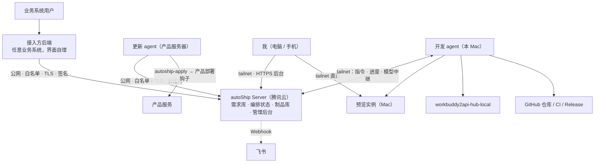
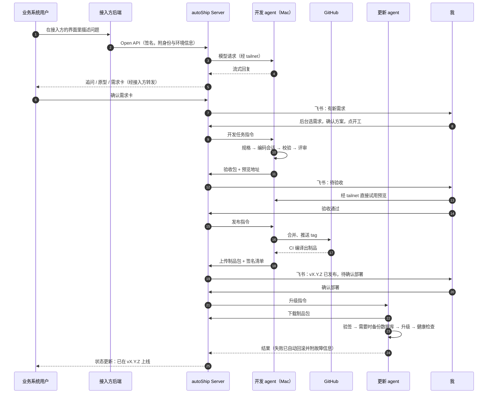
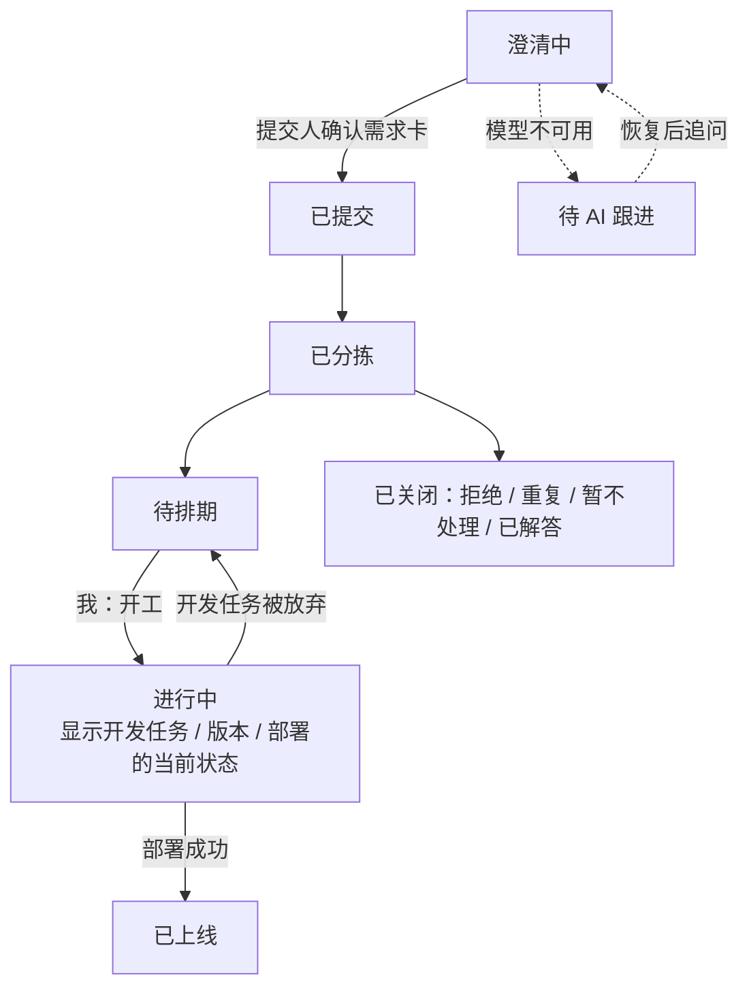
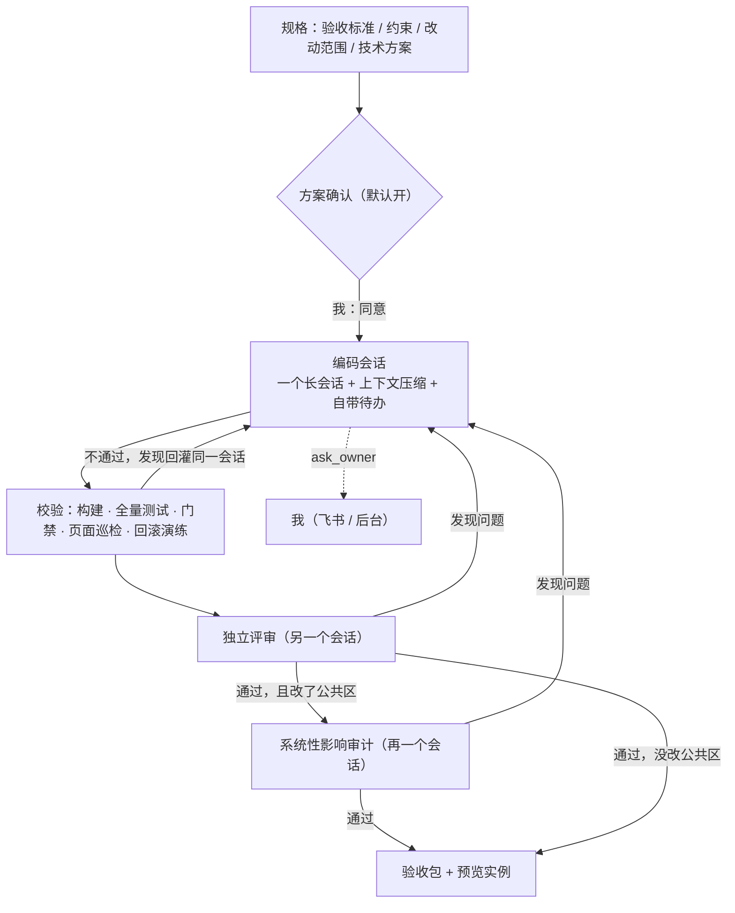

# autoShip 方案设计（草案 v0.3）

> 日期：2026-11-15 ｜ 版本：v0.3（并入审计结论与两轮确认）｜ 状态：待确认项已全部确认，尚未开工 ｜ 文件编码：UTF-8
> 上一版：`docs/archive/autoship-design-v0.2.md` ｜ 本版改了什么见附录 B

---

## 1. 目标

把“用户提出问题 → 新版本上线”做成闭环，并且**面向多个产品**：

1. 业务系统的用户提 bug / 需求，AI 客服通过对话问清楚，产出结构化需求卡和可视原型；
2. autoShip 汇总、分类、归档；
3. 我登录后台挑选需求、点“开工”，Mac 上的开发 agent 自动开发、测试，产出验收包和预览实例；
4. 我验收通过后，自动合并、打 tag，由产品自己的 CI 编译发布，制品签名后上传到 autoShip；
5. 我在后台确认部署后，产品服务器上的更新 agent 拉取新版本并升级，失败自动回滚，并把故障信息回传。

autoShip 是通用平台，不为某一个产品定制：

- 业务系统通过**标准 Open API** 接入。会话界面长什么样、放在哪个菜单，由接入方自己决定，autoShip 不关心；
- 每个产品用一份**产品档案**描述它怎么构建、测试、预览、发布、部署，autoShip 只按档案和契约办事；
- 三项能力可以分别接入：**需求收集**、**自动开发**、**自动部署**（见第 6 节）。

全流程有三个人工关口：**开工**、**验收**、**部署确认**。其余步骤自动执行，需要我决策时通过飞书找我。

## 2. 已确认的关键决策

| # | 决策点 | 结论 | 带来的设计影响 |
|---|---|---|---|
| 1 | 平台定位 | 通用平台，多产品从第一天就支持；接入方界面不归 autoShip 管 | 产品档案和接入契约是核心抽象；文档不再包含某个产品的界面和改造内容 |
| 2 | 客服 AI 用的模型 | 对话逻辑跑在 server；模型调用经 tailnet 请求 Mac 上开发 agent 的受限接口，再到本机 workbuddy2api-hub-local；直连其他接口做成配置开关 | Mac 离线时客服降级为“留言模式”；中继和直连是同一套客户端代码，只是地址不同 |
| 3 | 模型 | 当前用 hub 里的 deepseek-v4.1-flash（以 hub 中实际模型名为准） | 开工前先验证它做长时间编码任务的表现（第 13 节阶段 0） |
| 4 | 技术栈（autoShip 自身） | Go + Gin + GORM + MySQL 8，Angular + ng-zorro，前端内嵌单文件部署 | 认证、OTP、配置加密可参考现成实现；Cookie 用自己的名字前缀 |
| 5 | 开发引擎 | 自研循环，系统原生实现，尽量不调用外部能力，不用 pi。norma / ARTEX 只借鉴优点，不求一致，用不上的直接砍 | 第一版是“单个长会话 + 门禁”；默认不把 norma 作为依赖引入，只实现最小所需 |
| 6 | 网络 | 腾讯云服务器、Mac、我的设备都在同一个 tailnet；tailnet 内不另设访问策略。公网只对产品服务器的固定 IP 加白名单。不使用域名 | 后台和预览不上公网；删除预览隧道；公网入口只剩机器对机器 |
| 7 | 加密 | 不允许明文 HTTP | 公网段：TLS + 自建 CA + 固定指纹 + 请求签名；tailnet 段：WireGuard 之上仍用 HTTPS |
| 8 | 验收方式 | 验收包 + Mac 上的预览实例，我经 tailnet 直接访问。基本不看代码，重点看改动范围 | 验收包第一屏是“改动范围”；自动门禁承担回归和安全检查 |
| 9 | 改动范围 | 所有代码都可以改。本模块之外的改动要标记并说明；涉及公共区时追加一轮系统性影响审计 | 范围规则写进产品档案，用于标记和触发审计，不用于拦截 |
| 10 | Mac 隔离 | 按产品配置权限档案，一个产品一组权限。只限制 agent 启动的进程，不限制我自己的账号。妨碍依赖安装或工具使用时可以关掉 | 隔离是可选项，默认“保护”档；出问题优先放开 |
| 11 | 数据库备份 | 默认不备份。含数据改写的迁移版本，部署前导出到专用目录；超出存储上限时告警 | 备份由产品部署钩子执行，更新 agent 仍不持有数据库账号 |
| 12 | 升级时机 | 每次手动确认 | “待部署”状态：版本发布后飞书通知，我在后台确认才下发 |
| 13 | 更新 agent 运行账号 | 专用账号 + 受限 sudo | 常驻进程无特权，替换程序由 root 小工具再次验签后调用产品部署钩子 |
| 14 | 首版精简 | 查重合并流程、统计看板、提示词管理后台、通知规则、状态回调、嵌入式挂件后置 | 单产品反馈量小（几十人、每周十来条），先把主链路做扎实 |
| 15 | 分期顺序 | 验证 → 部署链路 → 开发循环 → 需求收集 | 需求先在后台手动录入；客服 AI 和 Open API 放在主链路打通之后 |

## 3. 总体架构



| 端 | 部署位置 | 职责 | 网络连接 |
|---|---|---|---|
| autoShip Server | 腾讯云 | 需求库、会话、编排状态、制品库、部署记录、管理后台、Open API、客服 AI 的对话逻辑 | 后台只监听 tailnet 地址；公网只开一个端口，按来源 IP 白名单；主动出站只有飞书和 tailnet 内的开发 agent |
| 开发 agent | 本 Mac | 开发循环、测试资源与预览实例、发布流水线、模型中继接口 | 只在 tailnet 地址上监听（中继接口、预览端口）；主动连 server；访问本机模型和 GitHub |
| 更新 agent | 产品服务器 | 心跳与版本上报、按固定流程升级 / 回滚 / 备份、故障回传 | 只主动连 server 的公网端口（HTTPS 长轮询） |
| 接入方 | 各业务系统 | 自己的会话界面；后端做签名代理 | 接入方后端 → server 公网端口 |

通信原则：

- 后台和预览只在 tailnet 内可达，不上公网；tailnet 内不另设访问策略；
- 公网入口只给接入方后端和更新 agent，安全组按固定来源 IP 放行，全程 TLS 加请求签名；
- 更新 agent 只从 server 下载制品，不访问 GitHub；
- 业务系统用户的浏览器不直连 autoShip，请求一律经接入方后端转发。

## 4. 端到端流程



### 4.1 四个对象各有各的状态

需求、开发任务、版本、部署是四个对象，各自维护状态。需求进入“进行中”以后，页面上显示的是后三者的当前状态，不再把所有环节挤在一条状态线上。



| 对象 | 状态 | 说明 |
|---|---|---|
| 需求 | 澄清中、待 AI 跟进、已提交、已分拣、待排期、进行中、已上线、已关闭 | 面向提交人的业务状态 |
| 开发任务 | 准备中、待确认方案、开发中、等待答复、待验收、已通过、已暂停、已放弃 | 打回后回到开发中；预算用尽进入已暂停；等待答复是 ask_owner |
| 版本 | 发布中、发布失败、待部署、已部署、已取代 | 发布失败后修复并用新的版本号重发，不移动已有 tag；更高版本部署后，未部署的旧版本标为已取代 |
| 部署 | 待确认、备份中、部署中、成功、失败已回滚、回滚失败 | 回滚失败触发飞书紧急通知；失败已回滚的版本可以重新部署 |

## 5. autoShip Server

### 5.1 模块划分

目录结构按 `internal/modules/<name>/{model,repository,service,handler,routes.go}`。

| 模块 | 职责 | 首版 |
|---|---|---|
| auth | 后台登录（密码 + OTP）、会话、登录限流 | 做 |
| product | 产品档案：仓库、分支、构建 / 测试 / 检查命令、模块与范围规则、权限档案、预览配方、发布配方、部署目标、产品知识 | 做 |
| integration | 接入方：App ID / 密钥、来源 IP 白名单、绑定的产品；Open API 验签 | 做 |
| intake | 澄清会话、消息、附件、需求草稿、原型版本；运行客服 AI | 做 |
| requirement | 需求库：状态、分拣、相似需求关联、提出人、标签、归档 | 做（合并流程后置） |
| work | 开发任务：关联需求、状态与门禁、改动范围、验收包、预览地址、验收意见 | 做 |
| run | 开发运行记录：活动流、会话记录引用、用量 | 做（图形化展示后置） |
| release | 版本：版本号、变更日志、tag / commit、CI 运行、制品清单与签名 | 做 |
| artifact | 制品存储：本地磁盘，保留最近 N 个版本 | 做 |
| deploy | 部署目标、部署确认、部署记录与分步日志、回滚与备份记录 | 做 |
| agent | agent 注册、凭据、心跳、在线状态、指令队列 | 做 |
| llm | 模型调用：按角色选择模型地址；用量统计 | 做 |
| notify | 飞书 Webhook 推送（一个地址，固定几类事件） | 做（通知规则后置） |
| audit | 后台操作、指令下发、审批、部署的全量审计 | 做 |
| stats / prompt | 统计看板、提示词版本管理后台 | 后置；首版在总览页放基础计数，提示词放配置文件 |

### 5.2 管理后台

只在 tailnet 内访问。

- **总览**：待处理需求、开发中、待验收、待部署、最近发布与部署；各 agent 在线状态与版本；模型是否可用。
- **需求池**：按产品 / 模块 / 类型 / 状态筛选；详情含完整对话、需求卡、原型、相似需求、时间线；操作：分拣、关联、拒绝、**手动录入需求**、开工。
- **开发任务**：活动流、待办清单、各道门状态、改动范围；回答 agent 的提问；预览地址；验收（通过 / 打回 + 意见）。
- **版本**：变更日志、制品与签名、CI 运行链接、部署历史；“确认部署”弹窗展示变更日志、包含的需求、迁移风险等级、是否先备份数据库、目标当前版本。
- **部署**：部署目标与 agent、分步日志、手动回滚、备份占用与告警。
- **设置 / 审计**：产品档案、接入方、agent 注册、模型地址、飞书地址。

### 5.3 客服 AI（需求澄清）

运行方式：server 上自己实现一个简单的对话循环（流式输出 + 无副作用工具），不依赖开发引擎。工具不能执行命令、不能读写文件。

| 工具 | 作用 |
|---|---|
| ask_user | 一次只问一个问题，最多 4 个可点选项 + 自由输入 |
| update_draft | 按需求类型更新草稿的结构化字段 |
| lookup_product | 查该产品的知识（模块、页面、已有功能、常见问题），咨询类当场解答 |
| search_similar | 在同产品的需求库里找相似需求，提示提交人并建立关联 |
| render_prototype | 生成单文件 HTML 低保真原型（按产品知识里的风格说明），可迭代多版 |
| propose_summary | 输出需求卡，请提交人确认 |
| submit | 提交；由代码校验必填项齐全、提交人已明确确认，否则拒绝 |

必填信息（按类型）：

- **缺陷**：所在页面 / 模块、操作步骤、期望结果、实际结果、出现频率、影响范围、报错或截图。版本、页面、浏览器、角色等环境信息由接入方自动附带。
- **新功能 / 改进**：使用角色、要解决的问题、期望行为、不包含的范围、验收标准（Given / When / Then）、界面期望（生成原型）、紧急程度。
- **咨询**：能用产品知识解答的直接回答，不进需求库。

原型：单个 HTML 文件，不引用任何外部资源。autoShip 只负责生成和保存版本，渲染由接入方完成；接入指南要求放在沙箱 iframe 里。缺陷类不出原型，改出“复现卡”。

完成门：提交由代码把关，必填项缺失或含糊、提交人没明确确认需求卡时一律拒绝。

离线降级（Mac 不在线或模型不可用）：新建会话时接口返回“表单模式”和按类型的表单定义，接入方按定义渲染；提交后状态为“待 AI 跟进”，模型恢复后按先进先出生成追问。

防滥用：用户输入、环境信息、截图内容一律按数据处理；每个会话有 token 预算；按接入方和提交人限频；附件限类型（png / jpg / webp）和大小（≤ 10 MB）；交给模型前可选对 IP / 邮箱脱敏（默认开启）。

### 5.4 需求库

- **自动分拣**（模型不可用时排队）：类型、所属模块、优先级建议、相似需求、工作量估计（S / M / L）、可开工度（验收标准是否可验证）。
- **相似需求**：提示并建立关联，记录提出人；正式的“合并为主需求”流程后置。
- **归档**：关闭的需求只读、可检索。
- **基础计数**：按产品 / 状态的数量、每个开发任务的 token 用量与耗时，放在总览页。

### 5.5 Open API

这是 autoShip 对外的唯一标准接口。接入方拿它做什么样的界面，autoShip 不关心。

| 约定 | 内容 |
|---|---|
| 认证 | 每个接入方一对 App ID / 密钥；请求头带时间戳、随机数和签名（HMAC-SHA256，覆盖方法、路径、时间戳、随机数、请求体摘要）；5 分钟时间窗 + 随机数防重放 |
| 来源限制 | 安全组和应用层各按来源 IP 白名单校验一次 |
| 接入方与产品 | 一个接入方绑定一个或多个产品；新建会话时指明产品 |
| 提交人身份 | 接入方提供稳定的外部用户 ID、显示名和可选属性；autoShip 以“接入方 + 外部 ID”识别提交人，信任接入方后端的鉴权结果 |
| 环境信息 | 自由 JSON（版本、页面、角色等）；接入方负责在发出前脱敏 |
| 幂等 | 写接口带 `Idempotency-Key`，重复提交返回同一结果 |
| 版本 | 路径带 `/open/v1`；同一版本内只增字段，不改不删 |
| 限流 | 按接入方、按提交人 |

| 接口（草案） | 说明 |
|---|---|
| `POST /open/v1/conversations` | 新建会话；返回对话模式或表单模式（含表单定义） |
| `POST /open/v1/conversations/{id}/messages` | 发消息；SSE 流式返回 |
| `POST /open/v1/attachments` | 上传截图 |
| `POST /open/v1/conversations/{id}/confirm` | 提交人确认需求卡 |
| `GET /open/v1/reporters/{rid}/issues` | 某提交人的反馈列表与状态 |
| `GET /open/v1/issues/{id}` | 需求详情与时间线 |
| `GET /open/v1/events?cursor=` | 增量拉取事件：状态变化、有新追问、已上线 |

SSE 事件类型：`message.delta`（文字增量）、`ask`（问题与选项）、`prototype`（原型版本）、`summary`（需求卡）、`status`、`error`、`done`。

状态同步用接入方轮询 `events`，server 不主动回调接入方（与“server 主动出站只有飞书”一致）。状态回调和嵌入式挂件后置。

## 6. 产品接入契约

三项能力可以分别接入。某个系统可以只当需求入口，也可以三项都接。

| 能力 | 接入方 / 产品要提供 | autoShip 提供 |
|---|---|---|
| 需求收集 | 自己的会话界面；后端签名代理；发出前对环境信息脱敏；在沙箱 iframe 里渲染原型 | Open API、客服 AI、需求库 |
| 自动开发 | 代码仓库；产品档案：构建 / 测试 / 检查命令、模块目录与范围规则、预览配方、开发规范、权限档案 | 开发 agent、门禁、验收包、预览 |
| 自动部署 | 满足下方契约的部署钩子；健康检查接口；可查询的版本号；CI 能按 tag 产出制品 | 制品库、签名、更新 agent、部署记录 |

**产品档案**（自动开发）主要内容：

- 仓库地址、默认分支、专用推送凭据；
- 命令：安装依赖、构建、全量测试、静态检查；每条命令的预期耗时上限；
- 模块表：每个模块对应的目录；公共区目录；可选的受保护路径；
- 预览配方：启动命令、需要的端口数、测试数据库前缀、演示数据怎么生成、怎么加载证书；
- 开发规范：注入给模型的约束，以及对应的自动检查器；
- 权限档案（见 8.3）。

**部署钩子契约**（自动部署）：产品在服务器上提供一个固定路径、归 root 所有的脚本或程序，支持下列子命令：

| 子命令 | 要求 |
|---|---|
| `install <制品> --deployment <ID>` | 备份当前版本并记录“部署 ID → 备份位置”；安装；启动。启动失败自行恢复并返回非零 |
| `rollback --deployment <ID>` | 回到该次部署之前的那一份；重复执行结果不变；当前已是目标版本时什么都不做 |
| `backup-db --deployment <ID> --dir <目录>` | 导出数据库到指定目录，输出文件清单和大小；不支持时声明不支持 |
| `status` / `logs <N>` / `cleanup` | 服务状态；最近 N 行日志；清理旧的程序备份 |

其他要求：

- 对候选程序做的任何预检都以服务账号执行，不以 root 执行；
- 安装位置不从环境变量读取（`autoship-apply` 调用前也会清空环境变量）；
- 部署钩子随制品包一起发布并签名，由 `autoship-apply` 验签后安装到固定路径，保证新版本需要的新钩子能跟着上线；
- 健康检查接口免登录，返回状态、版本号、迁移是否完成，以及每个模块一个只读探测的结果；
- 表结构变更要能通过“回滚演练”（见 8.7）。

## 7. 通信与证书

### 7.1 统一消息信封

```text
{ id, type, seq, ack, ts, payload }
```

- 指令至少投递一次，接收方按 `id` 幂等；
- server 端指令队列状态：待投递 → 已投递 → 执行中 → 成功 / 失败 / 过期；
- 事件带递增 `seq`，断线重连后从最后确认的 `seq` 续传。

### 7.2 传输方式

| 对端 | 网络 | 传输 | 说明 |
|---|---|---|---|
| 接入方后端 | 公网 + 白名单 | HTTPS + HMAC 签名；SSE 流式 | 标准 Open API |
| 更新 agent | 公网 + 白名单 | HTTPS 长轮询（挂起 30 秒）+ POST 上报 | 频率低，长轮询对企业网络最稳 |
| 开发 agent：指令与进度 | tailnet | agent 主动连 server 的一条 WSS；15 秒心跳；断线指数退避；本地发件箱缓存离线期间的事件 | 一条连接只走一种流，不做多路复用 |
| 开发 agent：模型中继 | tailnet | server 直接请求开发 agent 的受限 HTTPS 接口（流式） | 与直连其他模型接口是同一套客户端 |
| 我的浏览器 | tailnet | HTTPS 访问后台；HTTPS 直连 Mac 上的预览 | 不经过公网 |

### 7.3 注册与认证

1. 后台新建 agent，生成一次性注册令牌（15 分钟有效）；
2. agent 首次启动时在本地生成 Ed25519 密钥对，用令牌登记公钥；
3. 之后每个请求都用 agent 私钥签名（带时间戳和随机数），按授权范围访问：更新 agent 只能访问自己部署目标的制品和部署记录；开发 agent 可访问开发任务和发布；
4. server 请求开发 agent 的中继接口时同样签名，开发 agent 校验后才转发；
5. 后台可随时吊销。

### 7.4 证书

- autoShip 首次启动时生成自己的 CA，签发两张服务端证书：公网端口的证书 SAN 写公网 IP，后台的证书 SAN 写 server 的 tailnet 地址；
- 更新 agent、接入方后端、开发 agent 都**固定 CA 指纹**，不固定服务端证书本身，以后换证书、换 IP 重签都不用改各端；
- 我自己的电脑和手机把 autoShip CA 装进系统信任一次，后台和预览都不再报证书警告；
- tailnet 内的流量本身已由 WireGuard 加密，仍然用 HTTPS：浏览器的安全 Cookie 等特性需要它，也不把安全压在单独一层上。

### 7.5 模型中继

- 开发 agent 在 tailnet 地址上提供一个与 OpenAI Chat Completions 兼容的受限接口，把请求转给本机 workbuddy2api-hub-local，流式分片原样回传；
- server 只按“角色”请求（intake / triage），开发 agent 在本地把角色映射到具体模型；API 密钥只在 Mac 上；
- 接口只转发到 Mac 上已配置的模型地址，不是通用代理；每个请求限制 `max_tokens`，整体限速；
- 客服对话有独立的并发槽，优先于后台开发任务；
- server 定时探活，不可用就触发留言模式；
- **直连开关**：server 的模型地址是配置项。以后要改用别的可直连接口，把地址换掉即可，不改代码。

### 7.6 预览访问

- 预览实例跑在 Mac 上，我经 tailnet 直接访问 `https://<Mac 的 tailnet 地址>:<端口>`，不经过 server；
- 预览证书由 autoShip CA 签发（SAN 为 Mac 的 tailnet 地址）。产品支持加载外部证书时直接用；不支持时由开发 agent 在本机做一层 TLS 转发；
- 预览和后台在不同主机上，Cookie 互不影响。同一个产品同时开多个预览时，它们在同一主机的不同端口上，登录状态可能互相顶掉，需要时重新登录即可；
- 预览保留到验收结束，或空闲 24 小时后自动停止。

## 8. 开发 agent（本 Mac）

### 8.1 运行环境

- Go 单文件，launchd 用户级服务开机自启；有任务在跑或有预览实例时用 `caffeinate` 阻止休眠；
- 模型配置：多个 profile（地址、密钥、模型、格式），默认指向 workbuddy2api-hub-local（`http://127.0.0.1:8788/v1`），当前模型 deepseek-v4.1-flash；按角色映射（编码者、评审者、客服中继）；多个 profile 顺序切换；每个任务有 token / 时长 / 轮数预算；
- 密钥存 macOS 钥匙串；
- 本地状态：Mac 上已有的 MySQL，独立库 `autoship_agent`，账号与模型可接触到的测试库账号分开；会话记录以 JSONL 落盘；server 保存引用和摘要。

### 8.2 工作区与测试资源

- 不碰我自己的工作目录；
- 每个产品一份专用克隆 `~/autoship/repos/<产品>`；每个开发任务一个 git worktree `~/autoship/work/<产品>/<任务ID>`，分支 `autoship/<任务ID>-<简述>`；
- 依赖缓存跨任务复用（锁文件没变就不重装），避免每个 worktree 重新装一遍；
- 每个产品一个专用数据库账号，只授权该产品的测试库和预览库前缀；测试库每次运行时创建、结束后删除；
- 端口池给测试 / 预览服务用；登记自己启动的进程 PID，只清理自己的进程；
- 页面检查：用本机已装的 Google Chrome 通过 CDP 截图和巡检，使用临时浏览器配置，不下载浏览器；
- GitHub：每个仓库一把只对该仓库有效的 deploy key 用于推送；CI / Release 用 GitHub REST API + 细粒度 PAT；网络不通时走本机代理；
- 并行开发任务默认 1 个（本机 16 GB 内存）。

### 8.3 权限档案（按产品）

目的是限制机器，不是限制我：我的账号、终端、工具链完全不受影响，被约束的只有 agent 启动的进程（模型执行的命令、构建、测试、预览实例）。

| 档位 | 行为 |
|---|---|
| 关闭 | 不做系统级限制，只靠工具守卫和审计 |
| 保护（默认） | 读取默认放行，只拦一份敏感清单；写入限定在允许目录；网络不限制，保证依赖能正常安装 |
| 自定义 | 在“保护”基础上按产品增减路径 |

- 敏感清单（禁止读取）：SSH 密钥、钥匙串、其他产品的仓库和工作区、agent 自己的凭据与状态、发布签名密钥；
- 允许写入：本任务的 worktree、依赖缓存目录、临时目录、该产品声明的其他目录；
- 被拦截时，活动流里明确显示“被权限档案拦截”和具体路径，后台可以一键把路径加入允许清单，或把该产品切到“关闭”；
- 原则：隔离一旦导致依赖装不上、工具跑不了，优先放开，不为隔离卡住开发；
- 实现方式开工时验证：候选是用 macOS 自带的沙箱按命令包一层（同一账号、同一工具链）。验证不可行就退回“关闭”档。

### 8.4 开发引擎

norma 和 ARTEX 只作借鉴。ARTEX 的“规划者派意图、每个意图开新会话”适合大范围并行探索；写一个需求是在一个工作区里串行深入，所以第一版不照搬这个调度结构，把力气放在会话外围的门上。



| 借鉴点 | 处理 | 说明 |
|---|---|---|
| 目标分解 | 保留 | 需求 → 可验证的验收标准 + 约束 + 改动范围 + 技术方案 |
| 证据校验 | 保留，核心 | 每条验收标准必须绑定本次运行真实产生的证据（测试名 + 退出码 + 输出摘录、构建日志、截图），由代码核验，不信模型自述 |
| 独立评审 | 保留 | 独立会话：对照需求、约束、规范评审代码，检查可疑改动（鉴权绕过、新增外联、硬编码凭据、无关改动） |
| ask_operator | 保留 | ask_owner：暂停并通过飞书 + 后台找我，回复后带着答案继续 |
| 工具守卫 | 保留 | 每次工具调用前检查命令与路径规则；全量审计 |
| 约束块 | 保留 | 开发规范 + 仓库内的 agent 说明文件 + 任务级约束，以最高优先级注入 |
| 开工前检查 | 保留 | 需求缺少可验证的验收标准时提示补充 |
| 停滞检测 | 保留 | 同一错误或同一失败测试重复 3 次无进展 → 提醒换思路，仍不行就 ask_owner |
| 收尾 | 保留 | 步数或时间用尽时先提交 WIP commit，记录已完成和未完成的事项 |
| 预算 | 保留 | 每个开发任务的 token / 时长 / 轮数上限，用尽即暂停并通知 |
| 不可信边界 | 保留 | 需求原文、环境信息、截图文字都标记为数据，不当作指令 |
| 规划者 ⇄ 意图队列 ⇄ 执行者 | 砍掉 | 改为单个长会话；真有大型跨模块任务证明需要时再加 |
| 探索图作调度器 | 砍掉 | 只保留活动流和证据记录，用于展示和追溯 |
| 跨过程检索 | 砍掉 | 单会话不需要 |
| 项目地图 | 简化 | 模块、目录、测试命令；每次发布后刷新，并导出为产品知识 |
| 模型池熔断 | 简化 | 多个 profile 顺序切换，失败退避重试 |
| 提示词版本后台、经验库 | 后置 | 提示词先放配置文件；经验库须我批准才生效 |

引擎由 autoShip 自己实现，不调用外部编码工具：

- 会话、工具调用、上下文压缩的做法借鉴 norma；默认不把它作为依赖引入，只实现最小所需。某一块自己实现的成本明显更高时，再按依赖规则评估；
- 内部保留一个执行器接口，只为以后替换实现留余地，不规划接入外部工具；
- ARTEX 采用 AGPL-3.0，只借鉴思路，不复制它的代码。

### 8.5 改动范围标记与公共区审计

所有代码都可以改。范围规则不用于拦截，而是用来说明“这次动了哪里”，并决定要不要多审一轮。规则写在产品档案里，在规格阶段由代码按需求所属模块划定三个区：

| 区 | 范围 | 规则 |
|---|---|---|
| 本模块区 | 需求所属模块的目录及其测试 | 自由改 |
| 其他模块区 | 其余模块的目录 | 可以改；逐项标记，附模型给出的理由 |
| 公共区 | 产品档案声明的公共目录、依赖文件、构建与部署脚本 | 可以改；逐项打特殊标记并附理由；**追加一轮系统性影响审计** |

- **两处记录**：写文件时记一次（同时提醒模型它正在改本模块之外的代码，要给出理由），校验阶段对最终 diff 再算一次；
- **三处呈现**：开发任务的活动流、验收包第一屏、飞书通知摘要（“本次改动涉及 N 个其他模块、M 处公共区”）；
- **方案确认门默认打开**：开工后先给我一页纸，列出打算动哪些模块、哪些公共文件、是否动表结构，我同意后才开始编码。

系统性影响审计（改了公共区才做，排在常规评审之后）：

1. 由代码算出被改动的公共代码被哪些模块引用，得到“受影响模块清单”；
2. 一个独立会话逐个模块判断连带影响：行为有没有变、调用方要不要跟着改、有没有会导致大面积不可用的情况（启动失败、公共中间件、路由、数据库连接、前端公共组件等）；
3. 对受影响模块补跑测试，页面巡检重点覆盖这些模块；发现缺少覆盖时补写测试；
4. 发现问题就回到编码会话修复；修复时公共区又有新改动的，重新审计；
5. 结论写进验收包：受影响模块清单、风险判断、做过的验证。

回归防线（防止改 A 导致别处大面积不可用）：

- 全模块测试都要通过；
- 既有测试不得被删除或跳过；对既有测试的修改逐项标记并说明理由，在验收包里单列；
- 用 Chrome 把所有模块的主页面走一遍，和主分支的基线比，不能新增页面报错和接口错误；
- 回滚演练（见 8.7）；
- 上线后的健康检查包含每个模块一个只读探测，失败自动回滚。

### 8.6 一个开发任务的阶段

1. **准备**：拉代码、建 worktree、建测试库、准备依赖；
2. **规格**：生成验收标准、约束、改动范围、技术方案；缺陷类先复现并写出失败的测试，再做根因分析和同类问题排查；
3. **方案确认**：我同意后继续；
4. **开发**：编码会话推进，直到每条验收标准都有证据；
5. **校验**：全量构建、全量测试、门禁、页面巡检、回滚演练、独立评审；改了公共区的再做系统性影响审计；不通过就回到开发；
6. **打包**：生成验收包、启动预览实例 → 待验收，飞书通知我；
7. **发布**：验收通过后执行（见 8.10）。

### 8.7 自动化门禁

门禁由两部分组成：产品档案里声明的命令（看退出码和输出），以及 autoShip 内置的检查器。内置检查器先覆盖 Go 和 TypeScript，其他技术栈在有产品需要时再加。

| 门禁 | 自动化方式 |
|---|---|
| 注释 | 新增 / 修改的函数、类型、类、方法必须有完整注释（按语言的检查器） |
| 数据库注释 | 新建表必须有表注释，字段必须有字段注释 |
| UTF-8 | 所有改动文件做 UTF-8 合法性检查 |
| 依赖版本 | 新增或变更依赖时查发布时间：未满 30 天、或有 LTS 却没选 → 暂停并飞书上报；不擅自升级已有依赖 |
| 依赖体积 | 新组件超过 10 MB → 立即暂停并飞书上报 |
| Bug 修复 | 缺陷类任务必须产出根因分析和同类问题排查清单，由评审检查 |
| 改动范围 | 标记本模块之外的改动；改了公共区的必须有通过的系统性影响审计（见 8.5） |
| 测试完整性 | 既有测试不得被删除、跳过；对既有测试的修改逐项标记并说明 |
| 回滚演练 | 上一版启动 → 候选版启动并完成迁移 → 写入一些数据 → 上一版再次启动，要求健康且表结构没有破坏性差异 |
| 迁移风险分级 | 无表结构变更 / 仅新增 / 含数据改写 / 含破坏性变更。含数据改写 → 部署前备份数据库；含破坏性变更 → 阻断发布，须我单独审批 |
| 端口占用 | 只清理自己登记过 PID 的进程 |
| 飞书上报 | ask_owner 统一走飞书 Webhook，同时在后台生成待办卡片 |

### 8.8 工具守卫

- 工作目录锁定在本任务的 worktree；
- **禁止**：模型直接 `git push`（推送只由发布流水线的代码执行）；worktree 之外的删除和 `git reset --hard`；`sudo`；`curl | sh`；修改 git 全局配置；
- **需审批**：破坏性数据库迁移；依赖变更（走依赖策略）；产品档案里另行声明的受保护路径（可选，默认没有）；
- **打标记后放行**：其他模块和公共区的改动（见 8.5）；
- 所有调用记审计日志并同步到 server。

工具守卫只能看到命令本身，看不到命令运行的程序内部做了什么；这部分由权限档案（8.3）补足。权限档案关闭时，接受这一风险。

### 8.9 验收包与预览实例

| 验收包内容 | 说明 |
|---|---|
| **改动范围**（第一屏） | 按模块列出改动的文件数和行数；其他模块的改动单列并附理由；公共区改动带特殊标记、理由和系统性影响审计的结论。由代码计算，不是模型写的摘要 |
| 验收标准对照表 | 每条标准的状态和证据链接 |
| 改动说明 | 模型写的摘要 + 关键 diff + 完整 diff 入口 |
| 构建与测试 | 通过 / 失败 / 新增的测试；全模块回归结果；页面巡检结果 |
| 评审结论 | 发现的问题及处理情况 |
| 页面截图 | 改动页面的前后对比 |
| 风险提示 | 迁移风险等级、配置变更、依赖变更 |
| 预览实例 | tailnet 访问地址 + 预览专用的随机测试账号 |
| 成本 | token 用量、耗时 |

预览实例按产品档案里的预览配方启动：本地编译候选版本，从端口池分配端口，预览库按本需求生成演示数据（不用生产数据）。预览在 Mac 上构建，和生产环境的平台可能不同，最终以 CI 产物和上线健康检查为准。

### 8.10 发布流水线

验收通过后由**代码**按固定步骤执行，模型只负责写变更日志的文字：

1. 验收绑定到具体提交。拉取最新主分支，把任务分支 rebase 上去：干净通过则重跑校验后继续；**有冲突则回到开发并重新验收**，不让模型解完冲突直接发布；
2. 定版本号：含新功能升次版本号，纯修复升修订号；在发布这一刻计算，验收弹窗里可以改；
3. 生成变更日志小节并提交；这个提交只允许改变更日志文件，由代码检查；
4. 产品有 CI 时，先在任务分支上跑一遍构建和测试，通过后再合并；
5. 快进合并到主分支，推送主分支和 tag，触发产品的发布 CI；
6. 轮询 CI 结果；失败则版本进入“发布失败”，附日志并飞书通知；
7. 下载制品，核对它来自本次 tag 对应的提交（CI 运行的提交号、制品摘要）；打成制品包（程序 + 部署钩子 + 清单）；清单含产品、版本、tag、commit、文件名 / 大小 / 哈希、变更日志、迁移风险等级、最低更新 agent 版本；用钥匙串里的 Ed25519 私钥签名；
8. 分片续传上传到 server → 版本状态变为“待部署” → 飞书通知我确认部署；
9. 清理 worktree、测试库、预览实例；刷新项目地图并同步产品知识。

同一产品的发布串行执行。首版一个开发任务对应一个版本。

## 9. 更新 agent（产品服务器）

### 9.1 权限分离

| 组成 | 运行身份 | 职责 |
|---|---|---|
| `autoship-agent` 常驻进程 | 专用账号 `autoship-agent`，无特权 | 连 server、心跳、下载制品包到暂存目录、首次验签、健康检查、上报 |
| `autoship-apply` 小工具 | root（经 sudo），只能执行固定子命令 | 再次验签后调用产品部署钩子：升级、回滚、备份数据库、读取固定条数的服务日志 |

- sudo 规则只放行几条完整命令，不带通配参数；
- `autoship-apply` 只从固定暂存目录取制品包，先复制到 root 专属目录，再用 root 持有的公钥验签，然后才交给部署钩子，防止验签后文件被替换；
- 调用部署钩子前清空环境变量；
- `autoship-apply` 自己记录“部署 ID → 备份位置和哈希”，回滚时按部署 ID 定位，不依赖“最新一份备份”；
- `autoship-apply` 本身、公钥文件、部署钩子归 root 所有，其他账号不可写。

### 9.2 配置与心跳

- 配置项：server 地址、autoShip CA 指纹、agent 身份密钥、部署目标 ID、健康检查地址；**不需要数据库账号**；发布签名公钥由 root 持有；
- 每 30 秒心跳：agent 版本、产品版本、服务状态、磁盘、备份目录占用。

### 9.3 固定流程

只执行内置流程，不接受任意命令：

| 流程 | 说明 |
|---|---|
| deploy 升级 | 只在我于后台确认部署后下发，步骤见 9.4 |
| rollback 回滚 | 按部署 ID 回到该次部署之前的版本，可重复执行 |
| backup 备份 | 升级流程内按需执行，也可在后台手动触发，见 9.5 |
| diagnose 诊断（后置） | 采集服务状态、最近 N 行日志、磁盘与内存、版本；脱敏、限大小 |
| self_update 自更新（后置） | 用同一套签名机制更新自己 |

### 9.4 升级步骤

每一步都上报进度：

1. 校验清单签名、产品与目标匹配、版本高于当前版本（降级只能走回滚流程）；
2. 预检：服务正在运行、磁盘剩余足够（制品、程序备份、需要时的数据库备份）、没有其他部署在跑（文件锁）；
3. 断点续传下载制品包到暂存目录，校验大小和 SHA-256；
4. 清单标为“含数据改写”或我在确认时勾选了备份 → 先备份数据库（9.5）；备份失败则中止，不停服务；
5. `sudo autoship-apply upgrade`：复制 → 再次验签 → 安装新的部署钩子 → 调用 `install`；
6. 上线检查：健康检查接口正常、版本号等于目标版本、迁移已完成、每个模块的只读探测通过、启动日志里没有崩溃。含迁移的版本使用更长的等待时间，迁移进行中不判失败；
7. 上线检查失败 → `sudo autoship-apply rollback`（按部署 ID）→ 确认旧版本健康；
8. 成功后清理旧的程序备份（保留最近几份）；
9. 上报结果：成功 / 失败已回滚 / 回滚也失败（飞书紧急通知）。失败时附故障信息：失败步骤、退出码、错误输出末尾、日志末尾、健康检查响应。

按部署 ID 幂等；本地记录操作日志，agent 中途重启也能如实上报最终状态。

### 9.5 数据库备份

默认不备份。只在下面两种情况执行：

- 清单的迁移风险等级是“含数据改写”；
- 我在“确认部署”弹窗里手动勾选了“先备份数据库”。

做法：

- 由产品部署钩子的 `backup-db` 执行（它以 root 运行，使用产品服务器上已有的数据库配置）；更新 agent 仍不持有数据库账号；
- 备份写到专用目录，例如 `/var/backups/autoship/<产品>/<部署ID>/`，归 root 所有；记录文件清单、大小、校验和；
- 每个部署目标配置**存储上限**和保留份数。占用超过上限时：飞书和后台告警，“确认部署”弹窗里同时提示；不自动删除旧备份，由我清理或调高上限；
- 磁盘实际剩余空间不够写下本次备份时，阻断本次部署（否则等于在没有备份的情况下上线一个改写数据的版本）；
- 备份成功才继续升级；
- 不自动恢复数据库。回滚程序后如果需要恢复数据，后台给出备份位置和恢复说明，由我手动执行。

## 10. 安全设计

| 方面 | 措施 |
|---|---|
| 更新通道（风险最高：等于能替换生产程序） | 清单用 Ed25519 签名，私钥只在 Mac 钥匙串里；常驻进程无特权，替换程序由 root 小工具复制后再次验签才执行；只执行固定流程；防降级；每次部署须我确认 |
| 公网暴露面 | 只开一个端口，按固定来源 IP 白名单；TLS + 固定 CA 指纹 + 请求签名；后台和预览不上公网 |
| 证书 | 自建 CA；各端固定 CA 指纹；我的设备安装 CA |
| agent 身份 | 一次性注册令牌 → Ed25519 身份 → 请求签名（时间戳 + 随机数）；按范围授权；可吊销 |
| Open API | HMAC 签名 + 时间戳 + 随机数防重放；每个接入方独立密钥；来源 IP 白名单；幂等键 |
| 管理后台 | 密码 + OTP、HttpOnly Cookie（自己的名字前缀）、登录限流、全量审计；写接口校验 Origin 并带与会话绑定的 CSRF 令牌 |
| 开发 agent | worktree 隔离、按产品的权限档案、工具守卫、改动范围标记、公共区系统性影响审计、模型无推送权限、每个仓库专用的推送凭据、开工 / 方案确认 / 验收三处人工确认、不可信边界、评审专查可疑改动 |
| 验收与发布 | 验收绑定提交；rebase 有冲突重新验收；发布阶段新增的提交只能改变更日志；核对制品来源 |
| 模型中继 | 只能转发到 Mac 上已配置的接口；server 的请求要签名；限 token、限速；密钥不出 Mac |
| 密钥 | 模型密钥、GitHub 凭据、签名私钥存 Mac 钥匙串；server 上的接入方密钥加密存储；日志和会话记录脱敏 |
| 用户数据 | 截图和环境信息可能含敏感内容：接入方发出前脱敏；server 交给模型前默认再脱敏一次；设置保留期限 |

已知并接受的风险：tailnet 内全互通，不另设访问策略；权限档案关闭时，模型运行的代码拥有与我的账号相同的文件访问能力。

## 11. 核心数据表（草案）

所有业务表都带产品标识。按规范，所有新建表都有表注释，所有字段都有字段注释。

| 领域 | 表 |
|---|---|
| 产品与接入 | `products`、`product_modules`、`product_scope_rules`、`product_permission_profiles`、`product_knowledge`、`integrations`、`integration_products` |
| 需求澄清 | `reporters`、`conversations`、`conversation_messages`、`attachments`、`prototypes` |
| 需求 | `requirements`、`requirement_links`、`requirement_reporters`、`requirement_events` |
| 开发 | `work_items`、`work_item_requirements`、`work_gates`、`work_scope_changes`（范围内外的改动与标记）、`run_activities`、`run_transcripts`（文件引用）、`preview_sessions` |
| 发布与部署 | `releases`、`release_artifacts`、`deploy_targets`、`deployments`、`deployment_steps`、`db_backups` |
| agent | `agents`、`agent_commands`、`llm_usage` |
| 平台 | `users`、`audit_logs`、`settings`、`open_events`（供接入方增量拉取） |

## 12. 分期计划

> 顺序已确认。理由：单产品只有几十人、每周十来条反馈，需求可以先在后台手动录入；手工发版和部署是每天都在重复的事，先自动化收益最大；开发循环最不确定，要尽早验证。

| 阶段 | 内容 | 交付价值 |
|---|---|---|
| 0 验证（2–3 天） | 先搭出自研最小循环的原型（之后直接作为阶段 2 的核心，不是一次性代码）。从某个产品的 git 历史挑 3 个真实任务（一个缺陷、一个单模块功能、一个前后端联动），回到改动前的提交让它各做一遍，模型用 deepseek-v4.1-flash，用产品自己的测试当裁判。通过标准事先写好：测试通过、没有越出预算、长会话下模型通道稳定；同时记录 token、耗时、是否支持看图。顺带验证权限档案的实现方式 | 用数据确认模型和自研循环够不够用，不够就先调整再往下做 |
| 1 基础 + 部署链路 | server 基础（登录、自建 CA、产品档案、agent 注册、飞书）+ 版本与制品库 + 确认部署 + 更新 agent（常驻进程 + root 小工具：升级 / 回滚 / 备份 / 故障回传）+ Mac 上的发布工具（下载制品、打包、签名、上传） | 手动发的版本也能一键部署 |
| 2 开发循环 | 后台手动录入需求 → 规格 → 方案确认 → 编码会话 → 门禁、改动范围标记与公共区审计 → 验收包与预览 → 自动发布 | 从需求到上线的主链路打通 |
| 3 需求收集 | Open API + 客服 AI + 模型中继接口 + 接入指南 | 用户的反馈直接进入闭环 |
| 4 增强 | 需求合并流程、统计看板、提示词管理后台、经验库、诊断流程、状态回调、嵌入式挂件、飞书卡片按钮、agent 自更新 | 增强 |

每个产品接入“自动开发”“自动部署”前，要先满足第 6 节的契约。首个产品的待办见附录 A。

## 13. 依赖与版本约束

| 依赖 | 现状 | 结论 |
|---|---|---|
| norma（上游 Autumn-27） | v0.4.3，发布于 2026-10-11，Apache-2.0 | 只作借鉴，默认不作为依赖引入 |
| norma（BaaRai fork） | ARTEX 实际编译用的 v0.4.6，发布于 2026-11-09 | 不满 30 天，不用 |
| ARTEX | AGPL-3.0 | 只借鉴思路，不复制代码 |
| 外部编码工具（pi 等） | 我平时通过 Cindy 使用 | autoShip 不调用，引擎自己实现 |
| Go 工具链 | 本机 1.27.3，发布于 2026-10-19 | 2026-11-18 起满 30 天，开工时再确认 |
| Angular / ng-zorro | 21.x | 开工时逐个核对发布日期 |
| 浏览器自动化 | chromedp + 本机 Chrome | 不下载浏览器，避开 10 MB 限制 |
| Tailscale | 已在用 | 沿用现状，不加访问策略 |
| Docker / gh CLI | 本机未安装 | 测试环境直接用本机 MySQL；GitHub 用 REST API |

开工时逐个核对版本和体积，不符合规范的按规范飞书上报、等我确认。

## 14. 风险与对策

| 风险 | 对策 |
|---|---|
| deepseek-v4.1-flash 和自研循环做长时间编码任务的能力未验证 | 阶段 0 先用真实任务验证；任务拆小；门禁、评审、审计兜底；模型地址可切换，内部保留执行器接口便于替换实现 |
| Mac 是单点：客服、开发、预览都依赖它 | 客服降级为留言 + 恢复后追问；任务在 server 排队；模型地址可切到直连接口 |
| 模型通道上游收紧导致不可用 | 多个 profile 顺序切换；直连开关 |
| 依赖 Tailscale：协调服务不可达时新连接可能建不起来 | 关键节点关闭密钥过期；安全组放行 UDP 41641 保证直连；后台不可达时不影响已下发的部署和更新 agent |
| 我基本不看代码，恶意或失控的改动可能混进来 | 改动范围标记；公共区系统性影响审计；全模块回归；独立评审专查可疑改动；验收绑定提交；每次部署手动确认；失败自动回滚 |
| 提示词注入诱导 agent 写后门或读取密钥 | 不可信边界；权限档案的敏感清单；模型无推送权限；专用推送凭据 |
| 权限档案影响依赖安装或工具使用 | 默认只拦敏感清单；被拦截有明确提示；可一键放行或整体关闭 |
| 表结构变更回滚后不兼容 | 回滚演练作为门禁；迁移风险分级；含数据改写的版本部署前备份 |
| 备份占满磁盘 | 专用目录、存储上限与保留份数；超限告警；磁盘不足时阻断部署 |
| 预览平台与生产平台有差异 | 产品 CI 在任务分支上跑构建和测试；上线健康检查 + 自动回滚 |
| 国内访问 GitHub 不稳定 | 开发 agent 支持代理；发布步骤可重试、下载可续传 |
| 多产品技术栈不同，门禁难以通用 | 门禁以产品档案里的命令为主；内置检查器按需增加 |

## 15. 实施前需要准备的事项

| 位置 | 需要准备 |
|---|---|
| 腾讯云 | 安全组：公网端口（如 8443）只对产品服务器的固定公网 IP 放行；后台只监听 tailnet 地址；可选放行 UDP 41641；安装 MySQL 8；确认制品库的磁盘空间 |
| 产品服务器 | 确认能主动访问腾讯云的公网端口；`autoship-agent` 账号、sudo 规则、`autoship-apply`、备份专用目录由安装脚本生成，需要用 root 执行一次 |
| 本 Mac | 给开发 agent 建专用 MySQL 账号；在钥匙串生成发布签名密钥；为每个产品仓库准备 deploy key 和细粒度 PAT |
| 模型 | 在 workbuddy2api-hub-local 里给开发 agent 单独建一个 API Key，便于统计用量和限额 |
| 我的设备 | 电脑和手机都加入 tailnet，安装 autoShip CA 证书 |

---

## 附录 A：首个产品（SecCenter）接入前的待办

这些是产品侧的事，不属于 autoShip 的设计范围；列在这里是因为不处理就无法满足第 6 节的契约。只接“需求收集”时不需要做。

| 待办 | 现状 | 对应契约 |
|---|---|---|
| 回滚按部署 ID 定位、可重复执行 | `deploy/ctl.sh:202` 取最新一份备份，回滚成功后又把换下的版本存为最新备份（215 行），第二次回滚会装回坏版本 | `rollback --deployment <ID>` 幂等 |
| 候选程序的预检改用服务账号执行 | `deploy/ctl.sh:84` 以 root 直接运行候选程序的 `--help` | 预检不以 root 执行 |
| 服务端注入版本号，提供免登录健康检查接口 | 只给扫描 Agent 注入了版本；没有全局健康检查接口 | 版本可查询、健康检查 |
| 部署钩子随制品发布 | `release.yml` 只发布一个约 160 MB 的二进制，不含 `ctl.sh` 和校验文件 | 制品包含部署钩子 |
| 迁移能通过回滚演练 | 启动时 `AutoMigrate`（`server/internal/database/database.go:53`）加各模块手写的收敛函数，已有 `DropTable` / `DropColumn`；旧版本回滚后会按自己的模型再改一次表 | 回滚演练、迁移风险分级 |
| 发布 CI 加测试；任务分支可触发构建和测试 | `release.yml` 只编译，不跑测试 | 任务分支 CI |
| 增加 `backup-db` 和旧备份自动清理 | 每次升级留一份程序备份，`cleanup` 需手动调用 | 备份与清理 |
| 填写产品档案里的范围规则 | 后端 office、library、document 互相引用，8 个模块依赖 system_settings；前端 `shared` 有 434 个文件 | 模块表与公共区 |

## 附录 B：v0.2 → v0.3 的变化

| 方面 | v0.2 | v0.3 |
|---|---|---|
| 定位 | 先接 SecCenter，多产品放在最后一期 | 通用平台，多产品从第一天支持；SecCenter 的界面模块和前置改造移出正文 |
| 预览访问 | 经 server 的预览隧道，按端口段区分，票据换 Cookie | 经 tailnet 直连 Mac；隧道、端口段、票据、Cookie 剥离全部删除 |
| 后台 | 公网端口 + 自建 CA | 只在 tailnet 内访问 |
| 开发 agent 连接 | 一条 WSS 上多路复用指令、进度、中继、隧道 | 指令与进度一条 WSS；模型中继是 server 对开发 agent 的普通 HTTPS 请求 |
| 开发引擎 | 对照 ARTEX：规划者、意图队列、执行者、开发图 | 自研的单个长会话 + 门禁；不调用外部编码工具 |
| 改动范围 | 无 | 所有代码可改；本模块之外的改动标记说明；公共区追加系统性影响审计；验收包第一屏 |
| Mac 隔离 | 仅工具守卫 | 按产品的权限档案，可关闭 |
| 数据库备份 | 一律不备份 | 含数据改写的版本部署前备份到专用目录，超限告警 |
| 迁移门禁 | 检测删除 / 重命名的迁移 | 回滚演练 + 迁移风险分级 |
| 回滚 | 调用“回到上一份备份” | 按部署 ID 定位，可重复执行 |
| 状态机 | 一条需求状态线 | 需求、开发任务、版本、部署四个对象各有状态 |
| 状态同步 | server 回调接入方 | 接入方轮询事件接口 |
| 分期 | 需求收集 → 部署 → 开发循环 | 验证 → 部署链路 → 开发循环 → 需求收集 |
